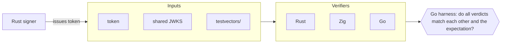

# authcraft

An educational OAuth 2.0 / OpenID Connect identity provider. The work checked in today is a Rust library that signs and verifies compact JWS and JWT values by hand, so the JOSE rules are visible and can later be compared across languages.

> **Educational project. Not production-ready. Do not deploy.**
> It exists to learn the protocols and to compare independent implementations of the same security-critical code. It has had no external review. For a real system, use an audited identity provider.

## What it is

Most identity code calls a JOSE library and then implements OAuth on top. This repository builds the JOSE layer itself: strict base64url, strict JSON, JWK and JWKS handling, thumbprints, signatures, and the checks a verifier runs before it trusts a token. The longer-term aim is an authorization server, with the same verifier written more than once. A shared set of test vectors, specified in [`testvectors/schema.json`](testvectors/schema.json) and [`docs/adr/0002-vectors-are-the-contract.md`](docs/adr/0002-vectors-are-the-contract.md), is how disagreements between those implementations become failing tests.

The library is the crate `jose` in [`rust/crates/jose`](rust/crates/jose). It is not published to crates.io (`publish = false`). The workspace also builds `jose-cli` with `verify`, `keygen`, `sign`, `jwks`, and `gen-vectors` subcommands. Zig ([`zig/`](zig/)) and Go ([`go/jose`](go/jose)) implement the same compact JWS/JWT verifier against the shared vectors; [`go/harness`](go/harness) differentially compares Go to `jose-cli`. There is no server.

## Features

What `jose` does now:

- Compact JWS signing and verification for a JSON object payload. `jose::signing::sign_compact` keeps the protected header bytes as given. `jose::verify::verify` returns the `kid`, algorithm, and parsed claims.
- `EdDSA` (Ed25519) and `ES256` (P-256, SHA-256) signing from a PKCS#8 private key. `jose::signing::generate_signing_key` creates that key. ES256 signatures are the 64-byte JOSE concatenation of `R` and `S`, not ASN.1 DER. Ed25519 signatures are deterministic.
- Verification of `EdDSA`, `ES256`, and `HS256`. `HS256` exists so the RFC 7515 Appendix A.1 vector can be checked. The signer refuses it. `HS256` keys must be at least 32 bytes. `none` cannot be named, and `RS256` is not implemented.
- JWK public keys for `OKP` / `Ed25519` and `EC` / `P-256`, plus `oct` secrets for `HS256` verification. RFC 7638 SHA-256 thumbprints for the two public key types, covered by [`rust/crates/jose/tests/thumbprint.rs`](rust/crates/jose/tests/thumbprint.rs) (RFC 8037 Appendix A).
- JWKS parsing and lookup by exact `kid`, with the key-selection rules in [`docs/adr/0003-verifier-check-order.md`](docs/adr/0003-verifier-check-order.md).
- A strict base64url codec (unpadded, canonical trailing bits) and a strict JSON parser that rejects duplicate member names.
- Claim checks for `iss`, `aud`, `exp`, `nbf`, and `typ`, using an explicit verification time.

Cryptographic primitives come from [`ring`](https://github.com/briansmith/ring) 0.17. The JOSE layer around them is written in this crate. The crate root is `#![forbid(unsafe_code)]`.

Out of scope for this layer, and not implemented: JWE, JWS JSON serialization, detached payloads, RSA, and SAML. The OAuth server is described under [Project status and roadmap](#project-status-and-roadmap). There is no UI, so this repository has no screenshots.

## Prerequisites

- Rust stable, 1.88 or newer. The base64url codec uses `slice::as_chunks`, which is unstable on Rust 1.83.
- A C compiler, because `ring` builds native code.
- Network access on the first build, to download the crates locked in [`rust/Cargo.lock`](rust/Cargo.lock).
- Zig 0.14.1 to build [`zig/`](zig/). [`zig/mise.toml`](zig/mise.toml) pins `zig = "0.14.1"`.
- Go 1.27.4 to build [`go/`](go/). [`go/mise.toml`](go/mise.toml) pins `go = "1.27.4"`.

[`rust/mise.toml`](rust/mise.toml) pins `rust = "stable"`. With [mise](https://mise.jdx.dev/) activated:

```bash
cd rust && mise install
cd ../zig && mise install
cd ../go && mise install
```

The Rust commands in the next sections were run with rustup stable (`rustc 1.99.0`) from `rust/`. The Zig tests were run with `mise exec -- zig build test` from `zig/` (`zig 0.14.1`). The Go tests were run with `mise exec -- go test ./...` from `go/` (`go 1.27.4`).

## Install

Clone the repository and build the workspace. Nothing is installed onto `PATH`.

```bash
cd rust
cargo build --workspace
```

That command succeeded with `cargo +stable build --workspace` on `rustc 1.99.0`.

## Usage

Call the library from Rust. The program below follows `signing::tests::creates_compact_jwt_that_verifies` in [`rust/crates/jose/src/signing.rs`](rust/crates/jose/src/signing.rs): generate an Ed25519 PKCS#8 key with `ring`, put its RFC 7638 thumbprint in the header as `kid`, sign a JSON object, and verify it with a JWKS that holds the matching public key. Generating the key uses `ring` directly, so the program depends on `jose` and on `ring` 0.17. This program was compiled against the crate and ran.

```rust
use jose::alg::Alg;
use jose::jwk::PublicKey;
use jose::jwks::Jwks;
use jose::signing::sign_compact;
use jose::verify::{self, Policy};
use ring::signature::{Ed25519KeyPair, KeyPair};

fn main() {
    let rng = ring::rand::SystemRandom::new();
    let pkcs8 = Ed25519KeyPair::generate_pkcs8(&rng).expect("generate Ed25519 key");
    let pair = Ed25519KeyPair::from_pkcs8(pkcs8.as_ref()).expect("parse Ed25519 key");
    let public = PublicKey::ed25519_from_bytes(pair.public_key().as_ref())
        .expect("valid Ed25519 public key");
    let kid = public.thumbprint();

    let jwks = Jwks::parse(
        format!(
            r#"{{"keys":[{{"kty":"OKP","crv":"Ed25519","x":"{}","kid":"{kid}"}}]}}"#,
            jose::b64url::encode(pair.public_key().as_ref()),
        )
        .as_bytes(),
    )
    .expect("valid JWKS");

    let header = format!(r#"{{"alg":"EdDSA","kid":"{kid}","typ":"at+jwt"}}"#);
    let token = sign_compact(
        Alg::EdDSA,
        pkcs8.as_ref(),
        header.as_bytes(),
        br#"{"iss":"issuer","aud":"api","exp":101}"#,
    )
    .expect("sign compact JWT");

    let verified = verify::verify(
        token.as_bytes(),
        &jwks,
        &Policy {
            algorithms: vec![Alg::EdDSA],
            issuer: Some("issuer".into()),
            audience: Some("api".into()),
            now: 100,
            leeway: 0,
            typ: Some("at+jwt".into()),
            max_token_bytes: 8192,
        },
    )
    .expect("newly signed JWT verifies");
    assert_eq!(verified.kid, kid);
    assert_eq!(verified.alg, Alg::EdDSA);
}
```

`sign` signs already-encoded ASCII `header.payload` bytes and returns the raw signature. `sign_compact` builds the three-segment token. Both reject `HS256`.

Build `jose-cli` with `cargo build --workspace`. Today it implements `verify`, `keygen`, `sign`, `jwks`, and `gen-vectors`.

```bash
cargo build -p jose-cli
./target/debug/jose-cli verify --jwks path/to/jwks.json --policy path/to/policy.json --token -
```

`--jwks` and `--policy` are required. `--token PATH` reads the compact token from a file; omitting `--token`, or passing `--token -`, reads it from stdin. Input is used byte-for-byte and is not trimmed, so pipe a token with `printf '%s'`, not `echo`: a trailing newline makes the compact serialization malformed.

`verify` prints exactly one JSON verdict on stdout:

- `{"ok":true,"kid":"...","alg":"..."}` and exit `0` when the token verifies.
- `{"ok":false,"error":"..."}` and exit `1` when verification rejects the token. The error is one of the stable codes in [ADR 0003](docs/adr/0003-verifier-check-order.md).
- No verdict and exit `2` for usage or configuration errors, including unreadable files, an invalid JWKS or policy, and empty stdin. The explanation is written to stderr.

Policy JSON uses the field names from [`testvectors/schema.json`](testvectors/schema.json):

| Field | Required | Constraint / default |
|---|---|---|
| `algs` | Yes | Array of `EdDSA`, `ES256`, or `HS256`. An empty array rejects every token. |
| `now` | Yes | Integer Unix timestamp. The CLI does not read the system clock. |
| `iss`, `aud`, `typ` | No | Strings. An omitted or non-string field is not checked. |
| `leeway` | No | Non-negative integer seconds; defaults to `0`. |
| `max_token_bytes` | No | Non-negative integer; defaults to `8192`. |

To exercise the CLI with a committed positive vector, extract its three inputs and run the same path used by the integration test:

```bash
python3 - <<'PY'
import json
from pathlib import Path

case = json.loads(Path("../testvectors/generated/pos-exp-one-second-ahead.json").read_text())
Path("/tmp/jwks.json").write_text(json.dumps(case["jwks"]))
Path("/tmp/policy.json").write_text(json.dumps(case["policy"]))
Path("/tmp/token.jwt").write_text(case["token"])
PY

./target/debug/jose-cli verify \
  --jwks /tmp/jwks.json \
  --policy /tmp/policy.json \
  --token /tmp/token.jwt
# {"ok":true,"kid":"k1","alg":"EdDSA"}
```

Run this from `rust/`, after building the CLI. Python is only used to unpack the test-vector JSON; it is not a runtime dependency of `jose-cli`.

`keygen` prints one JSON object on stdout and exits `0`. `2` is a usage error, with the message on stderr and no JSON. `--alg` is `EdDSA` or `ES256`. `HS256` is rejected. `pkcs8` is the unpadded base64url encoding of a PKCS#8 v2 private key, and `jwk` is the public key. Without `--kid`, `kid` is the RFC 7638 thumbprint of that public key.

```bash
./target/debug/jose-cli keygen --alg EdDSA
```

`sign` reads that keygen JSON from `--key`, plus protected-header and payload JSON files, and prints a compact JWS on stdout with no trailing newline. Exit `0` on success and `2` on usage or signing errors. `HS256` is rejected.

```bash
./target/debug/jose-cli sign --key key.json --header header.json --payload payload.json
```

`jwks` builds a JWKS document from one or more `--key` files (keygen JSON, using the `jwk` member, or a bare JWK). Each JWK needs a non-empty `kid`. The document is validated with the same parser `verify` uses, then printed on stdout. Exit `0` on success and `2` on usage or configuration errors (including duplicate `kid`).

```bash
./target/debug/jose-cli jwks --key key.json
```

`gen-vectors` writes the ADR 0003 generated vector set under `--out` (default `testvectors/generated`). Run it from the repository root. EdDSA cases are deterministic (RFC 8032 test-1 seed). The ES256 DER case is a fixed committed token. Exit `0` on success and `2` on usage errors.

```bash
./target/debug/jose-cli gen-vectors
./target/debug/jose-cli gen-vectors --out testvectors/generated
```

## Configuration

Nothing is read from the environment, a config file, or Cargo features. The caller passes a [`Policy`](rust/crates/jose/src/verify.rs) and a JWKS document.

| Field | Role |
|---|---|
| `algorithms` | Allowlist. The token header cannot add an algorithm. |
| `issuer` | When set, `iss` must equal this string. When omitted, `iss` is not checked. |
| `audience` | When set, `aud` must be that string or an array of strings containing it. |
| `now` | Verification time, Unix seconds. Expiry tests pass this in; the crate does not read the clock. |
| `leeway` | Clock skew in seconds, applied to `exp` and `nbf`. |
| `typ` | When set, the header `typ` must match, case-insensitively, after removing one leading `application/`. `at+jwt` and `application/at+jwt` match. |
| `max_token_bytes` | Tokens longer than this are `too_large`. The Rust struct has no default; the vector schema's default is 8192. |

The same field names appear in [`testvectors/schema.json`](testvectors/schema.json) and are used by the checked-in vectors under `testvectors/generated/` and `testvectors/rfc/` (`iss`, `aud`, `algs`, `now`, `leeway`, `typ`, `max_token_bytes`). The RFC files are compact examples copied from RFC 7515 and RFC 8037. Several of those headers have no `kid`, so ADR 0003 rejects them with `key_not_found` before the signature is checked.

JWKS JSON is an object with a `keys` array. Accepted public keys are `{"kty":"OKP","crv":"Ed25519","x":"..."}` and `{"kty":"EC","crv":"P-256","x":"...","y":"..."}`. `{"kty":"oct","k":"..."}` is for `HS256` verification only. `kid` is how a token selects a key. A duplicate `kid` is a configuration error from `Jwks::parse`. Header parameters that would fetch or embed a key (`jku`, `jwk`, `x5u`, `x5c`, `x5t`) are ignored.

The ordered checks and the exact error strings are specified in [`docs/adr/0003-verifier-check-order.md`](docs/adr/0003-verifier-check-order.md). In short: reject an oversized token, require three canonical base64url segments, parse the header, reject `crit`, enforce the algorithm allowlist and `typ`, select the key, verify the signature, and only then parse the payload and check `iss`, `aud`, `exp`, and `nbf`. `exp` is required. Fractional numeric dates are rejected.

## Development and testing

From `rust/` on stable Rust:

```bash
cargo test --workspace
cargo clippy --all-targets --all-features -- -D warnings
```

`cargo test --workspace` covers `jose`, `jose-cli`, `oauth` (including `testvectors/oauth/` and `testvectors/oidc/`), and `oauth-http` e2e. Clippy with `-D warnings` must pass on the same toolchain. Demo server: `cargo run -p oauth-http -- --demo` (see [docs/oauth-m1.md](docs/oauth-m1.md), [docs/oauth-m2.md](docs/oauth-m2.md)).

From `zig/` with Zig 0.14.1:

```bash
mise exec -- zig build test
```

That runs the Zig library tests (including the C ABI) and the shared-vector suite (`src/vectors.zig`). `zig build` installs `libauthcraft_jose.so` and `include/authcraft_jose.h` (ADR 0004).

From `go/` with Go 1.27.4:

```bash
mise exec -- go test ./...
```

That runs the Go library tests, the shared-vector harness, and (when `jose-cli` is on disk or `AUTHCRAFT_JOSE_CLI` is set) a differential check against Rust.

The shared vectors under `testvectors/` run against the Rust verifier as one integration test (it loops over every case; rejections must match on the exact error code):

```bash
cargo test -p jose --test vectors
```

A single thumbprint test:

```bash
cargo test -p jose --test thumbprint -- rfc8037_a3_thumbprint
```

`cargo fmt --all -- --check` currently reports diffs. The repository has no `rustfmt.toml` and does not treat formatting as a gate.

Useful design notes while changing verification:

- [`docs/rfc-conformance.md`](docs/rfc-conformance.md) — what M0 covers, what the Rust crate already implements, and what is still missing before anything is called conformant.
- [`docs/adr/0001-eddsa-default.md`](docs/adr/0001-eddsa-default.md) — why Ed25519 is the default and why `HS256` stays out of the default allowlist.
- [`docs/adr/0002-vectors-are-the-contract.md`](docs/adr/0002-vectors-are-the-contract.md) — vectors override an implementation, except when a vector disagrees with the specification.
- [`docs/adr/0003-verifier-check-order.md`](docs/adr/0003-verifier-check-order.md) — check order, error codes, and the minimum negative-vector list.
- [`docs/adr/0004-zig-c-abi.md`](docs/adr/0004-zig-c-abi.md) — Zig `authcraft_jose_verify` C ABI for embedding.
- [`docs/adr/0005-oauth-code-pkce.md`](docs/adr/0005-oauth-code-pkce.md) — M1 authorization code + PKCE profile.
- [`docs/adr/0006-oidc-core-code.md`](docs/adr/0006-oidc-core-code.md) — M2 OpenID Connect (code + PKCE) profile.
- [`docs/adr/0007-zig-edge-sidecar.md`](docs/adr/0007-zig-edge-sidecar.md) — Zig `authcraft-edge` JWT verify sidecar.
- [`docs/adr/0008-token-lifecycle.md`](docs/adr/0008-token-lifecycle.md) — M3 refresh / revoke / key rotation.
- [`docs/adr/0009-hardening-par-dpop.md`](docs/adr/0009-hardening-par-dpop.md) — M4 PAR / DPoP profile.
- [`docs/adr/0010-authentication.md`](docs/adr/0010-authentication.md) — M5 passwords / TOTP / WebAuthn.
- [`docs/adr/0011-control-plane.md`](docs/adr/0011-control-plane.md) — M6 admin / DCR / SCIM.
- [`docs/adr/0012-federation.md`](docs/adr/0012-federation.md) — M7 OIDC RP / LDAP federation.
- [`docs/adr/0013-assurance.md`](docs/adr/0013-assurance.md) — M8 attack harness / fuzz / conformance map.
- [`docs/adr/0014-private-key-jwt.md`](docs/adr/0014-private-key-jwt.md) — confidential clients with `private_key_jwt` (RFC 7523).
- [`docs/adr/0015-jar-request-objects.md`](docs/adr/0015-jar-request-objects.md) — signed request objects (RFC 9101 JAR).
- [`docs/adr/0016-protected-introspection.md`](docs/adr/0016-protected-introspection.md) — authenticated `/introspect` and resource-server clients.
- [`docs/adr/0017-mutual-tls.md`](docs/adr/0017-mutual-tls.md) — optional HTTPS listener and OAuth mutual TLS (RFC 8705).
- [`docs/adr/0018-enforcement-metadata.md`](docs/adr/0018-enforcement-metadata.md) — per-client mandatory PAR, DPoP, and certificate binding.
- [`docs/adr/0019-pki-tls-client-auth.md`](docs/adr/0019-pki-tls-client-auth.md) — PKI mutual-TLS client authentication (`tls_client_auth`).
- [`docs/adr/0020-redirect-uri-registration.md`](docs/adr/0020-redirect-uri-registration.md) — redirect URI registration rules.
- [`docs/adr/0021-http-security-headers.md`](docs/adr/0021-http-security-headers.md) — framing, referrer, cache, and HSTS headers.
- [`docs/adr/0022-second-factor-throttling.md`](docs/adr/0022-second-factor-throttling.md) — TOTP lockout and replay protection.
- [`docs/adr/0023-production-mode.md`](docs/adr/0023-production-mode.md) — `--demo` vs production mode, configured clients, persisted signing key.
- [`docs/adr/0024-persistent-accounts.md`](docs/adr/0024-persistent-accounts.md) — SQLite account storage and `email_verified`.
- [`docs/adr/0025-self-service-accounts.md`](docs/adr/0025-self-service-accounts.md) — email-verified sign-up, reset, login throttling.
- [`docs/adr/0026-sso-sessions.md`](docs/adr/0026-sso-sessions.md) — SSO sessions, `prompt`, account page, logout, ticket expiry.
- [`docs/adr/0027-public-deployment.md`](docs/adr/0027-public-deployment.md) — landing page and the accumu.cc VPS deployment ([runbook](deploy/README.md)).
- [`docs/oauth-m8.md`](docs/oauth-m8.md) — M8 assurance runbook.
- [`docs/openid-conformance-checklist.md`](docs/openid-conformance-checklist.md) — OIDF-style OP expectations vs authcraft.
- [`docs/oauth-m3.md`](docs/oauth-m3.md) — M3 token lifecycle runbook.
- [`docs/oauth-m4.md`](docs/oauth-m4.md) — M4 hardening runbook.
- [`docs/oauth-m5.md`](docs/oauth-m5.md) — M5 authentication runbook.
- [`docs/oauth-m6.md`](docs/oauth-m6.md) — M6 control plane runbook.
- [`docs/oauth-m7.md`](docs/oauth-m7.md) — M7 federation runbook.
- [`docs/rfc-9700-checklist.md`](docs/rfc-9700-checklist.md) — RFC 9700 BCP vs authcraft status.
- [`docs/threat-model.md`](docs/threat-model.md) — assets, adversaries, mitigations, and residual risks.
- [`docs/oauth-m1.md`](docs/oauth-m1.md) — how to run the M1 library and HTTP demo.
- [`docs/oauth-m2.md`](docs/oauth-m2.md) — how to exercise OIDC discovery, ID tokens, and UserInfo.

Agent instructions for working in this repository live in [`AGENTS.md`](AGENTS.md).

## Project status and roadmap

| Milestone | Scope | Status |
|---|---|---|
| **M0** | JOSE: JWS signing and verification, JWK/JWKS, thumbprints, shared test vectors | Complete for the verifier contract. Rust, Zig, and Go agree on `testvectors/`; Go differentials against `jose-cli`; CI regenerates vectors and runs all three suites; Zig exports `authcraft_jose_verify` (ADR 0004) and ships `authcraft-edge` (ADR 0007). |
| **M1** | OAuth 2.0 authorization code flow with PKCE | Complete. `oauth` library + `oauth-http` Axum binder (public clients, S256 required, stub login, in-memory codes, `testvectors/oauth/`). See [ADR 0005](docs/adr/0005-oauth-code-pkce.md) and [docs/oauth-m1.md](docs/oauth-m1.md). |
| **M2** | OpenID Connect: ID tokens, discovery, userinfo | Complete. `openid` scope → ID token (`nonce`, `at_hash`), discovery, UserInfo, `testvectors/oidc/`. See [ADR 0006](docs/adr/0006-oidc-core-code.md) and [docs/oauth-m2.md](docs/oauth-m2.md). |
| **M3** | Token lifecycle: refresh rotation, introspection, revocation, key rotation | Complete for B1–B3: rotating refresh, revoke/introspect, signing-key grace JWKS. See [ADR 0008](docs/adr/0008-token-lifecycle.md) and [docs/oauth-m3.md](docs/oauth-m3.md). |
| **M4** | Hardening: PAR, DPoP, RFC 9700 checklist | Complete for this slice: optional PAR + DPoP, plus [RFC 9700 checklist](docs/rfc-9700-checklist.md). See [ADR 0009](docs/adr/0009-hardening-par-dpop.md) and [docs/oauth-m4.md](docs/oauth-m4.md). |
| **M5** | Authentication: Argon2id passwords, TOTP, WebAuthn | Complete for this slice: Argon2id passwords, TOTP and WebAuthn second factors ([ADR 0010](docs/adr/0010-authentication.md), [docs/oauth-m5.md](docs/oauth-m5.md)). |
| **M6** | Control plane: admin API, dynamic client registration, SCIM 2.0 | Complete for this slice: admin API, RFC 7591 DCR, SCIM Users ([ADR 0011](docs/adr/0011-control-plane.md), [docs/oauth-m6.md](docs/oauth-m6.md)). |
| **M7** | Federation: OIDC relying-party connector, LDAP gateway | Complete for this slice: OIDC RP + LDAP MemoryDirectory gateway ([ADR 0012](docs/adr/0012-federation.md), [docs/oauth-m7.md](docs/oauth-m7.md)). |
| **M8** | Assurance: OpenID conformance suite, attack harness, fuzzing in CI | Complete for this slice: attack harness, fuzz smoke in CI, [OpenID conformance checklist](docs/openid-conformance-checklist.md) ([ADR 0013](docs/adr/0013-assurance.md), [docs/oauth-m8.md](docs/oauth-m8.md)). |
| **M9** | Public deployment: `authcraft.accumu.cc` as "Sign in with authcraft" for tacto and glossa | Complete for this slice. **A** authcraft production core: production mode ([ADR 0023](docs/adr/0023-production-mode.md)) ✓, persistent accounts ([ADR 0024](docs/adr/0024-persistent-accounts.md)) ✓, email-verified signup / reset and login rate limiting ([ADR 0025](docs/adr/0025-self-service-accounts.md)) ✓, SSO session + logout ([ADR 0026](docs/adr/0026-sso-sessions.md)) ✓, landing and account pages, Caddy + systemd deploy ([ADR 0027](docs/adr/0027-public-deployment.md), [deploy/README.md](deploy/README.md)) ✓. **B** glossa relying party (code + PKCE, `private_key_jwt`, connect from the account page) ✓ (glossa repo; verified against a real authcraft on loopback). **C** tacto relying party (same design in Zig) ✓ (tacto repo; verified against a real authcraft on loopback, including SSO across a logout). |

Post-M8 hardening has closed every row in the [RFC 9700 checklist](docs/rfc-9700-checklist.md) (ADRs 0014–0021); opt-in mechanisms list their demo default there. RFC 9207 `iss` on authorize success redirects is done (discovery advertises `authorization_response_iss_parameter_supported`). Confidential clients authenticate at `/token`, `/par`, and `/revoke` with `private_key_jwt` ([ADR 0014](docs/adr/0014-private-key-jwt.md), `testvectors/client_auth/`), and can send signed request objects (JAR, [ADR 0015](docs/adr/0015-jar-request-objects.md), `testvectors/jar/`). `/introspect` requires `private_key_jwt` callers; admin-registered resource servers may introspect any token ([ADR 0016](docs/adr/0016-protected-introspection.md), `testvectors/introspect/`). With `AUTHCRAFT_TLS_CERT` / `AUTHCRAFT_TLS_KEY` set, `oauth-http` serves HTTPS with optional mutual TLS: `self_signed_tls_client_auth` and certificate-bound tokens ([ADR 0017](docs/adr/0017-mutual-tls.md), `testvectors/mtls/`).

[`docs/rfc-conformance.md`](docs/rfc-conformance.md) is the M0 scope map and the rule for marking a behavior conformant (shared vectors plus agreement across implementations).

The intended shape, once M0 is filled in, is three implementations of one verifier contract:

| Language | Intended component | In this repository |
|---|---|---|
| Rust | JOSE signer and authorization-server core | `jose` + `oauth` / `oauth-http` (M1 code+PKCE, M2 OIDC). |
| Zig | JOSE/JWT verifier, a C ABI, and a small edge-auth sidecar | `zig/`: compact JWS/JWT verifier + C ABI (`authcraft_jose`) + `authcraft-edge` verify sidecar (ADR 0007) |
| Go | Control plane and the cross-implementation test harness | `go/jose` verifier + `go/harness` (vectors and differential vs `jose-cli`); control plane not started |



The Rust signer and the Rust, Zig, and Go verifiers in that diagram exist as library functions. Generated vectors under `testvectors/generated/` and the RFC compact examples under `testvectors/rfc/` run against all three (`cargo test -p jose --test vectors`, `mise exec -- zig build test` from `zig/`, `mise exec -- go test ./...` from `go/`). The Go harness also compares Go verdicts to `jose-cli` when that binary is available.

[`.github/workflows/ci.yml`](.github/workflows/ci.yml) regenerates `testvectors/generated/` with `jose-cli gen-vectors` and fails if the tree changes (ADR 0002), and runs the Rust, Zig, and Go test suites.

### Security notes

- Treat every component as unreviewed.
- SAML is deliberately not implemented. XML signature handling is a poor fit for a from-scratch project.
- Report suspected vulnerabilities by opening an issue. There is nothing here to keep private.

### Non-goals

- Production deployment or any form of support
- Full JOSE coverage (JWE, JSON serialization, every algorithm)
- SAML
- Competing with existing identity providers

## References

- [RFC 6749](https://www.rfc-editor.org/rfc/rfc6749): OAuth 2.0
- [RFC 7515](https://www.rfc-editor.org/rfc/rfc7515), [7517](https://www.rfc-editor.org/rfc/rfc7517), [7518](https://www.rfc-editor.org/rfc/rfc7518), [7519](https://www.rfc-editor.org/rfc/rfc7519): JWS, JWK, JWA, JWT
- [RFC 7636](https://www.rfc-editor.org/rfc/rfc7636): PKCE
- [RFC 7638](https://www.rfc-editor.org/rfc/rfc7638): JWK thumbprint
- [RFC 8032](https://www.rfc-editor.org/rfc/rfc8032), [8037](https://www.rfc-editor.org/rfc/rfc8037): EdDSA and its use in JOSE
- [RFC 8725](https://www.rfc-editor.org/rfc/rfc8725): JWT best current practices
- [RFC 9068](https://www.rfc-editor.org/rfc/rfc9068): JWT profile for OAuth 2.0 access tokens
- [RFC 9700](https://www.rfc-editor.org/rfc/rfc9700): OAuth 2.0 security best current practice
- [OpenID Connect Core 1.0](https://openid.net/specs/openid-connect-core-1_0.html)

## Licence

GNU General Public License, version 3. The license text is [`LICENSE`](LICENSE). Source files do not add a separate copyright header.
